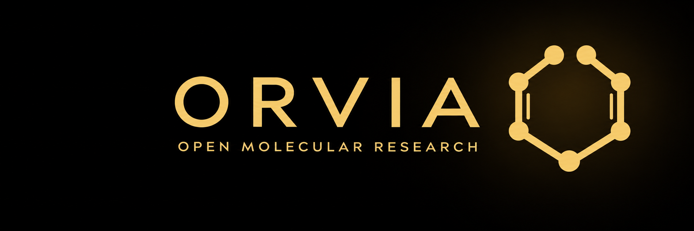
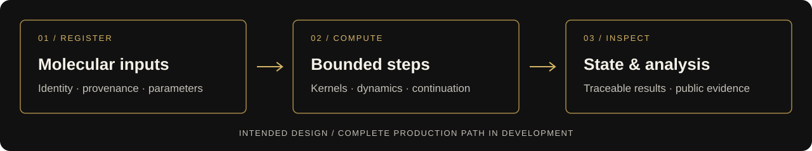

<p align="center">
  
</p>

<h2 align="center">$ORVIA is live</h2>

<p align="center"><strong>Robinhood mainnet · Token contract</strong></p>

<h3 align="center"><code>0x3e9094546fbfd726d96ef8433835d59415195f9a</code></h3>

<p align="center">
  <a href="https://robinhoodchain.blockscout.com/token/0x3e9094546fbfd726d96ef8433835d59415195f9a"><strong>View token contract</strong></a> &nbsp;·&nbsp;
  <a href="https://orvia.fyi"><strong>orvia.fyi</strong></a>
</p>

---

<h1 align="center">Open science. Inspectable computation.</h1>

<p align="center">
  Molecular research on Robinhood Chain.<br>
  Public inputs, reproducible methods, and evidence you can inspect.
</p>

<p align="center">
  <a href="docs/README.md"><strong>Explore the docs</strong></a> &nbsp;·&nbsp;
  <a href="STATUS.md"><strong>Research status</strong></a> &nbsp;·&nbsp;
  <a href="ROADMAP.md"><strong>Roadmap</strong></a> &nbsp;·&nbsp;
  <a href="CONTRIBUTING.md"><strong>Contribute</strong></a>
</p>

---

ORVIA stands for **Onchain Research through Verified Inference and Analysis**. We are building toward molecular calculations whose inputs, intermediate state and analysis can be inspected on-chain. The proposed first experiment compares compound 17 with aficamten in a declared cardiac-myosin state.

> **Deployed: GPU hybrid, 256 contracts on Robinhood mainnet.** All 33 transactions confirmed and all 256 runtime identities and registrations passed verification. The complete infrastructure deployment cost **0.004612876889674 ETH**. [Deployment evidence →](evidence/hybrid256/MAINNET_DEPLOYMENT.md) The full 132,935-atom complex and 151,505-atom solvent models also passed strict GPU/reference numerical checks with unchanged tolerances. Parameter, alchemical-endpoint and sampling acceptance remain open. [Current status →](STATUS.md)

## Find your starting point

| You want to… | Start here |
| :--- | :--- |
| Understand the research question | [Experiment protocol](docs/PROTOCOL_ORVIA_001.md) · [Scientific readiness](docs/SCIENTIFIC_READINESS.md) |
| Understand how the system works | [256-contract architecture](docs/ARCHITECTURE_256.md) · [Engine reference](docs/README.md#engine-reference) |
| Inspect what has been demonstrated | [Current prototype](docs/COMPLETE_256_PROTOTYPE.md) · [Validation evidence](reports/README.md) |
| See what remains | [Current status](STATUS.md) · [Production gaps](docs/PRODUCTION_GAPS.md) |
| Follow ongoing work | [Research log](RESEARCH_LOG.md) · [Development proposal](https://github.com/ORVIArh/ORVIA/pull/1) |

## Active GPU hybrid workflow

The user-selected hybrid computes molecular work on external GPUs and commits signed experiment, checkpoint and result hashes on chain. The 256 addresses are one coordinator/factory and 255 report shards. These are operator attestations, not proofs of correct computation. The separately named ADP/phosphate experiment preserves its chemical identity and does not replace the original vanadate protocol.

[Hybrid contracts and trust model](contracts/hybrid/README.md) · [GPU accuracy evidence](evidence/hybrid256/README.md) · [Current status](STATUS.md)

Run `npm run test:hybrid` for the dedicated local checks. No wallet or public-chain transaction is needed.

## Earlier fully on-chain prototype

<p align="center">
  
</p>

The design uses permissionless, bounded transactions to advance scientific work. The current prototype connects authenticated molecular inputs, retained simulation state, constrained or unconstrained sampling, spatial force evaluation, computed cross-state energies and analysis. Full prepared-model and physical sampling acceptance remain open; swap and pool triggers are deferred.

| Foundation | What is in this checkpoint |
| :--- | :--- |
| **Numerics** | Binary128-format arithmetic, bounded scalar functions and counter-addressed random streams |
| **Molecular mechanics** | Bond, angle, torsion and nonbonded forces; authenticated inputs; periodic geometry and finite Ewald |
| **Dynamics** | Connected BAOAB sampling with bounded SHAKE/RATTLE and ordered spatial pairs; alternative NVE and minimization paths |
| **Analysis** | On-chain cross-state samples, chronological selection, MBAR, overlap/ESS diagnostics and preregistered repeats |
| **Evidence** | Independent references, an actual local 256-address fixture, measured gas and read-only target-provider creation checks |

[Browse the current prototype and its limits →](docs/COMPLETE_256_PROTOTYPE.md)

The earlier fully on-chain build has no imposed dollar cap; its complete workload costs remain unmeasured. Its inventory contains **32 core contracts and 224 fixed storage banks**. Thirty-one core components participate in the connected architecture; the raw C4 pair kernel is exercised separately and is not integrated into the alchemical Hamiltonian. The fixture preregisters three repeat pairs but completes one campaign’s two-state analysis, not all repeats or a full prepared-myosin run.

## Reproduce the checkpoint

The recorded research environment uses **Node.js 24.22.1** and **Python 3.12.14**. Run from the repository root:

```bash
npm ci
python3.12 -m venv .venv-research
.venv-research/bin/python -m pip install -r requirements-research.txt
ORVIA_RESEARCH_PYTHON=.venv-research/bin/python npm run check
```

The checks use an in-process local EVM and require no wallet or mainnet RPC. The runner regenerates reports for the checked source. Native molecular-preparation checks additionally require the separate declared AmberTools/OpenMM environment; see [ligand preparation](docs/LIGAND_PREPARATION_v0_1.md) before running the complete development suite. See [Contributing](CONTRIBUTING.md) for individual commands and [the evidence guide](reports/README.md) for how to read results.

## Repository map

```text
ORVIA/
├── contracts/       Numerical kernels, state and coordinators
├── data/            Molecular inputs, provenance and manifests
├── reference/       Independent Python calculations
├── test/            Node/EVM checks
├── scripts/         Validation, preparation and packaging tools
├── docs/            Methods, architecture and research decisions
├── reports/         Recorded evidence, reviews and measurements
└── assets/brand/    Repository artwork
```

## Read the results in context

The earlier fully on-chain [ORVIA-256 architecture](docs/ARCHITECTURE_256.md) counts every router and storage bank. Its 256 addresses were deployed locally; the [target-provider probe](docs/TARGET_256_CREATION_PROBE.md) separately returned exact runtime bytes for the two large coordinators through read-only calls. No persistent target-chain deployment followed. Small fixtures do not establish full-system accuracy, sufficient sampling, complete campaign costs or production throughput.

The [v0.5.1 checkpoint](docs/DEVELOPMENT_CHECKPOINT.md) passed 212 Node/EVM tests, 63 Python references and nine check groups. Those results and its earlier 64-slot plan are historical; they do not validate the changed v0.6.0-dev source. The [current validation summary](reports/validation_summary.json) is explicitly incomplete.

[Scientific readiness](docs/SCIENTIFIC_READINESS.md) · [Workload feasibility](docs/WORKLOAD_FEASIBILITY.md) · [Mainnet readiness](docs/MAINNET_READINESS.md)

---

**Attribution** · This product includes software developed by ABDK Consulting. The vendored source retains its [BSD-4-Clause license](contracts/math/vendor/LICENSE.md) and provenance. Scientific-source attribution and redistributed-model terms are recorded in the [source audit](docs/SOURCE_AUDIT.md) and [model provenance](data/source/alternative_models/README.md).
